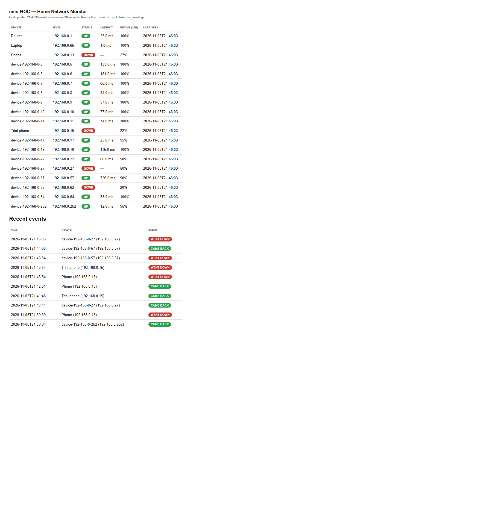
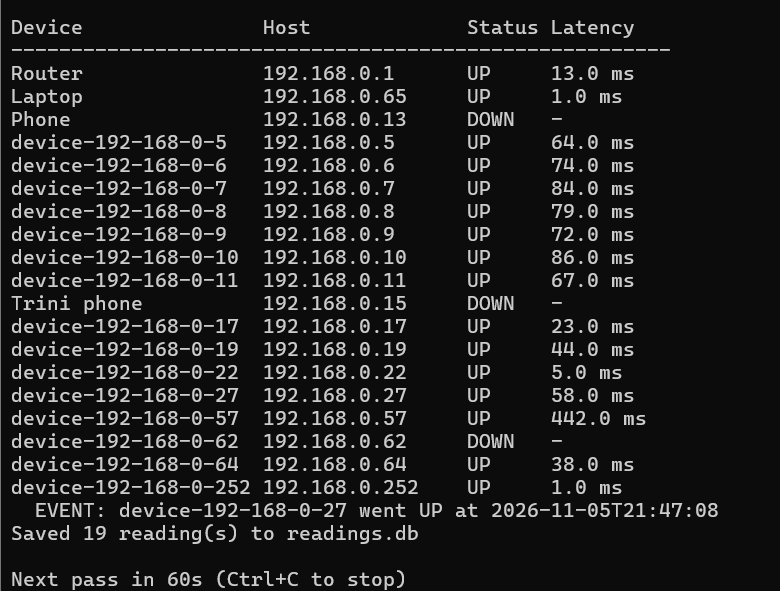

# Home Network Monitor (mini-NOC)

A small network monitoring dashboard for a home network. It pings the
devices on your network, records uptime and latency in SQLite, and shows
live status on a web dashboard. Built as a portfolio project to show
hands-on networking and monitoring skills — the kind of work a NOC or
network technician does every day.

## What it does

- **Pings every device** in `devices.json` and records UP/DOWN plus latency in SQLite (`readings.db`)
- **Auto-discovers devices** — a parallel ping sweep of the whole subnet finds everything that answers, and compares it with the ARP table (`discover.py`)
- **Live web dashboard** — Flask page at http://localhost:5000 with UP/DOWN status, latency, 24-hour uptime % per device, and a recent-events list; refreshes every 30 seconds
- **Watch mode** — `python monitor.py --watch` repeats every 60 seconds and logs an event whenever a device goes down or comes back
- **Uptime %** — a phone that sleeps a lot shows ~60% instead of just DOWN, so sleeping devices read as "sleeps a lot", not "broken"

## Results from my network

First run (Nov 5, 2026), on a 192.168.0.x home network:

| Device | Host | Status | Latency |
| --- | --- | --- | --- |
| Router | 192.168.0.1 | UP | 7.0 ms |
| Laptop | 192.168.0.65 | UP | 1.0 ms |
| Phone | 192.168.0.13 | DOWN | — (asleep on Wi-Fi) |

The discovery sweep found **about 20 devices** — phones, TVs, printers,
consoles, smart devices. The sweep pings 50 addresses at a time, so the
whole /24 finishes in seconds instead of ~4 minutes one by one.

## How to run it

1. Install Python 3.11 or newer (https://www.python.org/downloads/)
2. Open a terminal in this folder
3. Install the web dependency (needed for the dashboard):
   `pip install -r requirements.txt`
4. Put your real device IPs in `devices.json` — on Windows, run
   `ipconfig`: the "Default Gateway" is your router, your laptop's own
   IP is the "IPv4 Address" in the same output, and your phone's IP is
   in its Wi-Fi settings. Or run `python discover.py --save` and let
   the sweep find them for you.
5. Run the monitor:
   `python monitor.py` — one pass, prints a status table
   `python monitor.py --watch` — repeats every 60 seconds until Ctrl+C
6. Start the dashboard in a second terminal:
   `python app.py` — then open http://localhost:5000

## Project structure

- `monitor.py` — pings devices, writes readings to SQLite, logs UP/DOWN change events
- `discover.py` — parallel ping sweep of the subnet, ARP table comparison, `--save` adds new devices to `devices.json`
- `app.py` — Flask web dashboard (status table, 24h uptime %, recent events)
- `templates/index.html` — the dashboard page
- `devices.json` — devices to watch (edit with your real IPs; the IPs in this repo are examples)
- `readings.db` — SQLite database of ping results and events (created on first run, not committed)
- `requirements.txt` — Flask, for the dashboard
- `SESSION_PLAN.md` — the five-session build plan this was built from

## What I learned

- **Networking:** ICMP ping, ARP tables, subnets (/24 sweep), why phones and TVs show DOWN when they sleep
- **Monitoring:** uptime %, latency tracking, down/up event logging, polling on a schedule vs. one-off checks
- **Tools:** Python (subprocess, threading for the parallel sweep), SQLite, Flask

## Sessions

Built in five morning sessions — setup + first monitor, device discovery,
web dashboard, history + alerts, portfolio-ready. See `SESSION_PLAN.md`.
